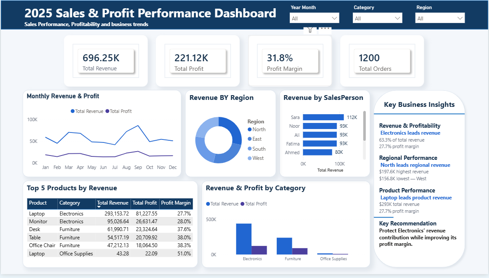

📊 2025 Sales Performance Analysis

An end-to-end data analytics project focused on evaluating sales performance, profitability, regional trends, product performance, and customer purchasing behavior throughout 2025.

The project uses Excel, Power Query, SQL, and Power BI to transform raw sales data into meaningful business insights and actionable recommendations.

⸻

📌 1. Project Overview

The objective of this project is to analyze 2025 sales transactions, evaluate business performance, identify trends and performance gaps, and provide data-driven recommendations to support business planning for 2026.

Dataset: 1,200 sales transactions covering the 2025 fiscal year.

🛠️ 2. Tools & Technologies

Tool	Purpose
Excel	Initial data review and preparation
Power Query	Data cleaning and transformation
SQL	Data analysis and querying
Power BI	Data modeling and dashboard development
DAX	KPI calculations and business metrics

🧹 3. Data Preparation & Cleaning

Data preparation was performed using Power Query to improve data quality and ensure consistency.

Key activities included:

* Removing unnecessary spaces from categorical fields.
* Handling missing Customer IDs.
* Recovering missing Unit Price and Discount values using available transaction data.
* Validating Revenue and Profit calculations.
* Checking Order IDs for duplicates.
* Verifying data types, missing values, and numerical ranges.

📐 4. Data Model & DAX

A structured data model was developed in Power BI using a dedicated Date Table connected to the sales transaction table.

Key DAX measures included:

* Total Revenue
* Total Profit
* Profit Margin
* Total Orders
* Total Customers
* Average Order Value (AOV)
* Revenue Growth
* Profit Growth
* Repeat Customer Rate

📈 5. Dashboard Preview

The interactive Power BI dashboard provides an overview of sales and profitability performance.

Key Performance Indicators

| KPI | Result |
|---|---:|
| Total Revenue | $696.25K |
| Total Profit | $221.12K |
| Profit Margin | 31.8% |
| Total Orders | 1,200 |

Dashboard Features

* Monthly Revenue & Profit Trends
* Revenue by Region
* Revenue by Salesperson
* Top 5 Products by Revenue
* Revenue & Profit by Category
* Interactive filters for Year, Month, Category, and Region

🔍 6. Key Business Insights

Revenue & Profitability

* Electronics generated 63.3% of total revenue ($440.6K), with a profit margin of 27.7%.
* Office Supplies achieved the highest profit margin at 51.7%.

Regional Performance

* North generated the highest revenue at $197.6K.
* West generated the lowest revenue at $155.6K.
* Regional profit margins ranged from 31.4% to 32.2%.

Product Performance

* Laptop was the largest revenue-generating product, contributing approximately $293K.
* Its profit margin was relatively low compared with several other products.

Customer Behavior

* 95.6% of customers placed more than one order during 2025.

💡 7. Business Recommendations

* Protect the strong revenue contribution of Electronics while improving its profitability.
* Explore opportunities to increase sales of higher-margin categories such as Office Supplies.
* Investigate regional performance gaps, particularly the lower revenue generated by West.
* Monitor high-revenue products such as Laptop to ensure sales growth is supported by healthy profit margins.

📁 8. Project Files

File	Description
Sales_Data.xlsx	Sales dataset
Sales_Performance_Dashboard.pbix	Power BI dashboard file
Sales_Performance_Dashboard.pdf	Dashboard PDF export
Project_Documentation.docx	Detailed project documentation
dashboard.PNG	Dashboard preview image

🎯 9. Project Deliverables

* Cleaned and validated sales dataset.
* Power BI data model and DAX measures.
* Interactive 2025 Sales & Profit Dashboard.
* Business insights and recommendations.

⸻

Project Type: Data Analytics / Business Intelligence
Period: 2025
Author: Bushra Abdualwali Abuhuliqah
